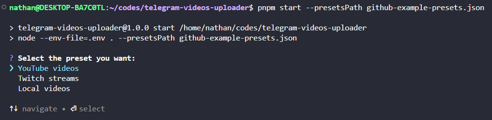
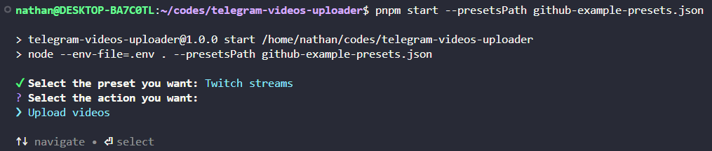
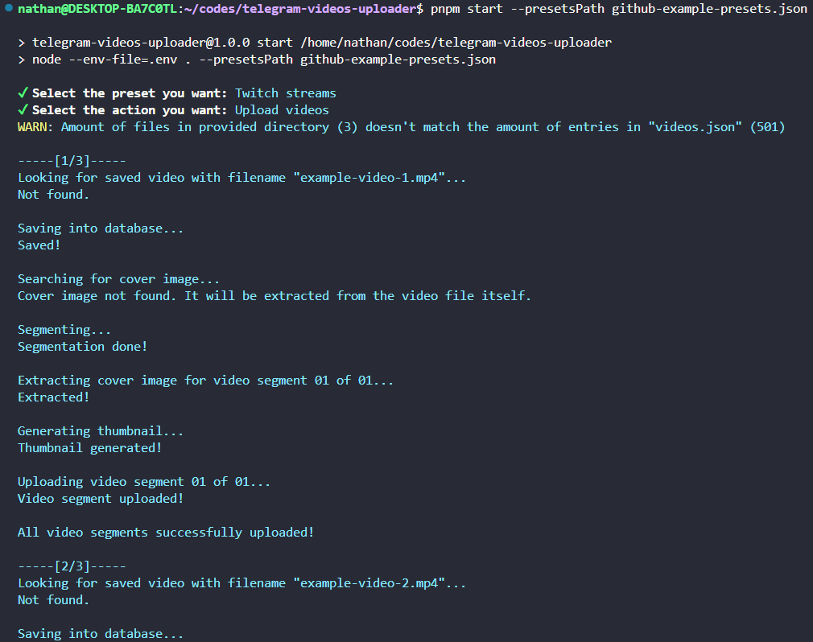

🇺🇸 You are reading the Portuguese version. [Click here to read the English version.](./README.md)

# telegram-videos-uploader
Uploader de vídeos para o Telegram usando Node.js e TypeScript.

## Imagens





## Sumário
- [Sobre o projeto](#sobre-o-projeto)
- [Configuração e Instalação -> Requisitos mínimos](#requisitos-mínimos)
- [Configuração e Instalação -> Instalação](#instalação)
- [Configuração e Instalação -> Instalação -> Linux](#instalando-no-linux)
- [Configuração e Instalação -> Instalação -> Windows 10/11](#instalando-no-windows-1011)
- [Configuração e Instalação -> Entendendo a diferença entre servidores da `Bot API`](#entendendo-a-diferença-entre-servidores-da-bot-api)
- [Configuração e Instalação -> Variáveis de ambiente](#variáveis-de-ambiente)
- [Configuração e Instalação -> Criando o arquivo `settings.json`](#criando-o-arquivo-settingsjson)
- [Configuração e Instalação -> Subindo o servidor local da `Bot API`](#subindo-o-servidor-local-da-bot-api)
- [Configuração e Instalação -> Subindo o servidor local da `Bot API` -> Linux](#servidor-local-no-linux)
- [Configuração e Instalação -> Subindo o servidor local da `Bot API` -> Windows 10/11](#servidor-local-no-windows-1011)
- [Uso -> Rodando o projeto](#rodando-o-projeto)
- [Uso -> Como funciona](#como-funciona)
- [Uso -> Sobre o arquivo `videos.json`](#sobre-o-arquivo-videosjson)
- [Uso -> Sobre o arquivo `videos.json` -> Rodando o script no Windows 10/11](#rodando-o-script-no-windows-1011)
- [Uso -> Limitações](#limitações)
- [Contribuindo](#contribuindo)
- [Licença](#licença)

## Sobre o projeto
Este projeto é capaz de fazer o upload de vídeos para o Telegram através da `Bot API`, utilizando um bot previamente adicionado ao canal em que se deseja fazer o upload dos vídeos. Foi desenvolvido por Nathan Murillo, cujo perfil no GitHub pode ser encontrado [clicando aqui](https://github.com/NathanMBR).

## Configuração e Instalação
### Requisitos mínimos
- Node.js 24 ou superior
- pnpm 9 ou superior
- CLI do ffmpeg
- CLI do ffprobe
- CLIs do bash e do jq (necessárias somente para utilizar o script de conversão do `videos.json`; veja [nesta seção](#sobre-o-arquivo-videosjson); no Windows 10/11, utilize o Git Bash que acompanha o Git)
- Token de um bot do Telegram + ID do canal em que os vídeos serão postados (o bot precisa ter permissão para enviar mensagens)
- Arquivo de configuração `settings.json` (veja [nesta seção](#criando-o-arquivo-settingsjson))
- (Somente no Windows 10/11) Modo de Desenvolvedor ativado (veja [nesta seção](#instalando-no-windows-1011))

### Instalação
Os passos variam de acordo com o sistema operacional. Siga os do seu: [Linux](#instalando-no-linux) ou [Windows 10/11](#instalando-no-windows-1011).

#### Instalando no Linux
1. Instale o Git, o ffmpeg (o ffprobe vem junto com ele) e, opcionalmente, o jq, utilizando o gerenciador de pacotes da sua distribuição. No Debian/Ubuntu, por exemplo:
    ```bash
    sudo apt update
    sudo apt install git ffmpeg jq
    ```

2. Instale o Node.js 24 ou superior. A versão disponível nos repositórios da sua distribuição pode ser mais antiga, então verifique-a com `node --version` e, caso necessário, instale uma mais nova seguindo [as instruções oficiais](https://nodejs.org/pt-br/download).

3. Instale o pnpm (veja [o guia de instalação dele](https://pnpm.io/installation) para outras opções):
    ```bash
    npm install -g pnpm
    ```

4. Clone o repositório e instale as dependências:
    ```bash
    git clone https://github.com/NathanMBR/telegram-videos-uploader.git
    cd telegram-videos-uploader
    pnpm install
    ```

#### Instalando no Windows 10/11
Rode os comandos abaixo no **PowerShell**. No Windows 11, clique com o botão direito no botão Iniciar e escolha **Terminal**; no Windows 10, pesquise por **PowerShell** no menu Iniciar.

1. Permita que o PowerShell rode os comandos `npm` e `pnpm`. Por padrão, o Windows os bloqueia com o erro `running scripts is disabled on this system` (ou `a execução de scripts foi desabilitada neste sistema`). Responda `S` caso seja pedida uma confirmação:
    ```powershell
    Set-ExecutionPolicy -Scope CurrentUser -ExecutionPolicy RemoteSigned
    ```

2. Ative o **Modo de Desenvolvedor**:
    - Windows 11: **Configurações → Sistema → Para desenvolvedores** (nas versões mais recentes, essa página pode se chamar **Avançado**);
    - Windows 10: **Configurações → Atualização e Segurança → Para desenvolvedores**;
    - Em ambos, também é possível pesquisar por "configurações de desenvolvedor" no menu Iniciar.

    Quando um vídeo é pequeno o suficiente para ter o upload feito em uma única parte, a ferramenta coloca um link simbólico para ele na pasta de segmentos, e o Windows só permite que usuários comuns criem links simbólicos com o Modo de Desenvolvedor ativado. Sem ele, o upload desses vídeos falha com o erro `EPERM: operation not permitted, symlink`. Como alternativa, você pode rodar o terminal como administrador toda vez que utilizar a ferramenta.

3. Instale o Git, o Node.js e o ffmpeg (o ffprobe vem junto com ele) com o `winget`. Caso seja pedido para aceitar os termos da fonte, responda `Y`:
    ```powershell
    winget install --id Git.Git -e
    winget install --id OpenJS.NodeJS.LTS -e
    winget install --id Gyan.FFmpeg -e
    ```

    > **Nota:** O `winget` já vem com o Windows 11. No Windows 10, caso o comando `winget` não seja reconhecido, instale ou atualize o aplicativo **Instalador de Aplicativo** pela Microsoft Store.

4. Feche o terminal e abra um novo, para que os programas recém-instalados possam ser encontrados, e verifique-os (o Node.js precisa estar na versão 24 ou superior):
    ```powershell
    git --version
    node --version
    ffmpeg -version
    ffprobe -version
    ```

5. Instale o pnpm:
    ```powershell
    npm install -g pnpm
    ```

6. Clone o repositório e instale as dependências:
    ```powershell
    git clone https://github.com/NathanMBR/telegram-videos-uploader.git
    cd telegram-videos-uploader
    pnpm install
    ```

> **Nota:** Os scripts do diretório `scripts` são scripts em bash. No Windows 10/11, rode-os no **Git Bash**, que é instalado junto com o Git (pesquise por ele no menu Iniciar).

### Entendendo a diferença entre servidores da `Bot API`
O Telegram fornece dois modos de utilizar a `Bot API`:

1. Pelo servidor oficial (disponível através do link `https://api.telegram.org`);
2. Por um servidor local auto-hospedado.

O servidor oficial não requer certas configurações que seriam necessárias para o local, mas em contrapartida possui limites de upload curtos (cerca de 50 MB para vídeos). Um servidor local possui limites bem maiores (2000 MB), mas requer o registro de uma aplicação no Telegram e a obtenção de um ID e de um hash de API. Felizmente, este repositório conta com um arquivo [`compose.yml`](./compose.yml) que pode ser utilizado para subir rapidamente um servidor auto-hospedado utilizando Docker Compose, bastando apenas fornecer as variáveis de ambiente necessárias (verificar [a seção abaixo](#variáveis-de-ambiente)).

Você pode ver mais sobre os benefícios de um servidor de API auto-hospedado [clicando neste link](https://core.telegram.org/bots/api#using-a-local-bot-api-server), e entender como registrar a aplicação e obter as informações necessárias [clicando neste outro link](https://core.telegram.org/api/obtaining_api_id).

### Variáveis de ambiente
O arquivo `.env` **precisa existir** para que a ferramenta inicie, mesmo que você não vá utilizar o servidor local da `Bot API`: `pnpm start` e `pnpm dev` o leem na inicialização e param com o erro `node: .env: not found` caso ele não exista. Crie-o copiando o arquivo de exemplo `.env.example` e substitua com os valores que possui:

```bash
# Linux
cp .env.example .env
```

```powershell
# Windows 10/11 (PowerShell)
Copy-Item .env.example .env
```

Tabela com as variáveis de ambiente disponíveis:

| Variável | Obrigatória? |  Descrição |
|---|---|---|
| `TELEGRAM_API_ID` | Não | ID de API do Telegram* |
| `TELEGRAM_API_HASH` | Não | Hash de API do Telegram* |

> **\*Nota:** Obrigatório se você for utilizar o servidor local da `Bot API` pelo Docker Compose.

> **Nota:** A localização do banco de dados **não** é uma variável de ambiente: ela é definida por preset através da propriedade `databaseUrl` dentro do arquivo `settings.json` (veja [nesta seção](#criando-o-arquivo-settingsjson)). Caso você não pretenda utilizar o servidor local da `Bot API`, pode deixar os valores de exemplo copiados como estão — apenas não delete o arquivo.

### Criando o arquivo `settings.json`
Você também pode copiar o arquivo de exemplo [`settings.example.json`](./settings.example.json) e substituir com os valores que possui:
```bash
# Linux
cp settings.example.json settings.json
```

```powershell
# Windows 10/11 (PowerShell)
Copy-Item settings.example.json settings.json
```

Exemplo com comentários:
```jsonc
{
  // (Opcional) Tamanho aproximado, em megabytes, de cada parte em que um vídeo é dividido antes do upload
  // Deve ser um número inteiro entre 10 e 1990; o padrão é 1792 (1.75 GB)
  // Caso você utilize o servidor oficial da Bot API, defina um valor bem abaixo do limite de upload dele (cerca de 50 MB)
  "targetUploadSizeInMB": 1792,

  // Lista de presets exibidos na seleção de presets (é necessário pelo menos um)
  "presets": [
    {
      "name": "Meu Preset", // Nome do preset, utilizado na seleção de presets
      "origin": "qualquer-coisa", // (Opcional) Identificador qualquer, útil quando você tem mais de um preset e deseja diferenciar os dados no banco de dados
      // URL do banco de dados SQLite utilizado por este preset, no formato "file:nome-do-arquivo.db"
      // Caminhos relativos são resolvidos a partir do diretório em que o comando for executado; também é possível utilizar um caminho absoluto ("file:/caminho/para/database.db")
      // Cada preset pode apontar para o seu próprio arquivo de banco de dados, e o arquivo (junto de suas tabelas) é criado automaticamente caso ainda não exista
      "databaseUrl": "file:database.db",
      "targetUploadSizeInMB": 1024, // (Opcional) Sobrescreve o "targetUploadSizeInMB" do nível superior somente para este preset
      "telegram": {
        // URL base da API para o upload dos vídeos
        // Caso necessário, troque para o endereço do servidor local da Bot API rodando no Docker Compose
        "apiBaseUrl": "https://api.telegram.org",
        "botToken": "0000000000:XXXXXXXXXXXXXXXXXXXXXXXXXXXXXXXXXXX", // Token do BOT do Telegram
        "channelId": "-100XXXXXXXXXX" // ID do canal em que os vídeos serão postados
      },
      "videosDirectory": "/diretorio/dos/videos", // Diretório onde os seus vídeos estão
      "postDescription": {
        // (Opcional) O texto base que será publicado junto com o vídeo, que pode ser um array de strings (como abaixo) ou uma string única
        // Caso seja um array, as strings são concatenadas com quebra de linha (\n)
        // O texto suporta MarkdownV2 (como pode ser visto na linha que começa com "Título"), mas não é obrigatório utilizá-lo
        "baseText": [
          "Título: #VIDEO_TITLE", // Isso faz o texto do placeholder #VIDEO_TITLE ser clicável e direcionar para o link do placeholder #VIDEO_URL
          "Descrição: #VIDEO_DESCRIPTION",
          "Canal: [#CHANNEL_TITLE](#CHANNEL_URL)", // A mesma coisa do título se aplica aqui
          "Disponibilidade: #AVAILABILITY",
          "Publicado em: #DATE",
          "Parte: #PART_CURRENT de #PART_TOTAL"
        ],

        "channel": {
          "name": "My Channel [Twitch]", // (Opcional) Nome do canal de onde o vídeo saiu, que será substituído no placeholder #CHANNEL_TITLE
          "url": "https://www.twitch.tv/mychannel" // (Opcional) Link do canal de onde o vídeo saiu, que será substituído no placeholder #CHANNEL_URL
        },

        // (Opcional) Formato da data do placeholder #DATE
        // "DD" significa "dia", "MM" significa "mês" e "YYYY" significa "ano"
        // Verifique o arquivo "Preset.ts" dentro do diretório "./src/domain" para verificar todos os formatos disponíveis
        "dateFormat": "MM/DD/YYYY",

        // (Opcional) Mapeamento dos estados de disponibilidade possíveis
        // O estado "unknown" é utilizado quando o vídeo não possui disponibilidade definida no arquivo videos.json
        "availability": {
          "private": "Privado",
          "premiumOnly": "Somente para usuários do YouTube Premium",
          "subscriberOnly": "Somente para membros do canal / subs",
          "needsAuth": "Público (requer login)",
          "unlisted": "Não-listado",
          "public": "Público",
          "unknown": "Desconhecido"
        }
      }
    }
  ]
}
```

O arquivo `settings.json` é carregado automaticamente caso esteja no diretório raiz do projeto. Caso queira salvá-lo com um nome ou em um diretório diferentes, você pode apontar o caminho do arquivo com uma flag ao rodar o comando. Verifique essa opção [na seção abaixo](#rodando-o-projeto).

> **AVISO:** O arquivo `settings.json` deve ser salvo sem nenhum comentário.

> **Nota (Windows 10/11):** Em JSON, a barra invertida (`\`) é um caractere especial, então escreva os caminhos do Windows — como o do `videosDirectory` — com barras normais (`"C:/Users/SeuNome/Videos"`) ou com barras invertidas duplicadas (`"C:\\Users\\SeuNome\\Videos"`). Um caminho com barras invertidas simples torna o arquivo inválido.

> **Nota:** Caso você já possua um arquivo `presets.json` de uma versão anterior, renomeie-o para `settings.json` e mova o array dele para a propriedade `presets`: `{ "presets": [ ... ] }`. A flag `--presetsPath` (`-p`) também foi substituída por `--settingsPath` (`-s`).

### Subindo o servidor local da `Bot API`
Após confirmar que as variáveis de ambiente estão corretamente inseridas, suba o servidor seguindo os passos do seu sistema operacional abaixo. Assim que ele estiver rodando, defina a propriedade `telegram.apiBaseUrl` do seu preset como `http://localhost:8081`.

#### Servidor local no Linux
É necessário ter o Docker Engine com o plugin do Docker Compose (veja [o guia de instalação do Docker](https://docs.docker.com/engine/install/)). A partir da pasta do projeto, rode:
```bash
sudo docker compose up -d
```

#### Servidor local no Windows 10/11
1. Instale o Docker Desktop e reinicie o computador:
    ```powershell
    winget install --id Docker.DockerDesktop -e
    ```

2. Abra o Docker Desktop, aceite os termos dele e aguarde até que ele informe que o engine está rodando. Caso ele peça para instalar ou atualizar o WSL, aceite.

3. A partir da pasta do projeto, no PowerShell, rode:
    ```powershell
    docker compose up -d
    ```

O Docker Desktop precisa estar aberto sempre que você quiser utilizar o servidor local.

## Uso
### Rodando o projeto
Os comandos são os mesmos no Linux e no Windows 10/11 (no PowerShell). Rode-os a partir da pasta do projeto:
```bash
# Uso padrão: build + start
pnpm build
pnpm start

# Para uso rápido
pnpm dev

# Apontando para um arquivo settings.json diferente
pnpm start --settingsPath /new/path/to/settings.json
pnpm start -s /new/path/to/settings.json

# Dry run
pnpm start --dryRun
pnpm start -d
```

Tabela com as flags disponíveis:

| Flag | Atalho | Tipo | Padrão | Descrição |
|---|---|---|---|---|
| `--settingsPath` | `-s` | Texto | `settings.json` no diretório onde o comando é rodado | Caminho do arquivo `settings.json` |
| `--dryRun` | `-d` | Booleano | `false` | Roda as ações sem converter arquivos, persistir informações no banco de dados ou enviar qualquer alteração para o canal do Telegram |

### Como funciona
O código lê o conteúdo do arquivo `settings.json` presente na raiz do projeto para obter suas configurações. A partir daí, pede primeiramente ao usuário para selecionar um dos presets listados na propriedade `presets` do arquivo. Logo após a seleção, conecta-se ao banco de dados definido na propriedade `databaseUrl` do preset e aplica as migrations pendentes automaticamente (criando o arquivo do banco de dados caso ele ainda não exista), e depois pede para selecionar uma ação.

As ações disponíveis são:

- **Trocar preset:** volta para a seleção de presets. O arquivo `settings.json` é lido novamente, a conexão com o banco de dados do preset atual é fechada, e o banco de dados do preset recém-escolhido é conectado e migrado, assim como na inicialização. É a primeira opção do menu.

- **Checagem dos dados do preset:** não faz nenhum upload. Imprime as principais configurações do preset escolhido (nome, origem, banco de dados, diretório de vídeos, nome do canal, URL do canal e formato de data) e depois consulta a `Bot API` do Telegram para imprimir os dados do canal (título e descrição) e do bot (nome e nome de usuário) para os quais o preset realmente aponta. Em seguida, imprime um resumo do banco de dados para a origem do preset: quantos vídeos estão armazenados, quantos deles têm exatamente 1, 2, 3… partes, quantos uploads (partes) estão armazenados no total e quantos uploads existem para cada número de parte. É útil para confirmar que o token do bot, o ID do canal e a URL da API estão corretos antes de iniciar um upload.

- **Checagem dos dados do vídeo:** não altera nada. Exibe uma lista pesquisável dos vídeos registrados para o preset escolhido — a busca filtra por nome de arquivo, título e descrição — e imprime tudo o que a ferramenta guarda sobre o selecionado: ID no banco de dados, título, descrição, disponibilidade, status (armazenado localmente ou enviado), nome do arquivo, URL do vídeo original, data de publicação e as datas de criação e da última atualização no banco de dados. Em seguida, imprime um bloco por parte já enviada daquele vídeo, cada um com o seu ID de mensagem no Telegram. A disponibilidade e as datas são exibidas com os textos e o formato de data definidos no preset, e os campos sem valor aparecem como `(empty)`. Ao final, pergunta `Return to menu?` (a resposta padrão é sim).

- **Checagem da lista de vídeos por disponibilidade:** não altera nada. Pede que você escolha um estado de disponibilidade (exibido com os textos definidos no preset) e imprime os títulos de todos os vídeos registrados para o preset escolhido com aquela disponibilidade, ordenados por título. Ao final, pergunta `Return to menu?` (a resposta padrão é sim).

- **Upload de vídeos:** lê os dados dos vídeos do arquivo `videos.json` dentro do diretório de vídeos do preset (caso exista) para utilizar como referência. Caso o diretório também possua vídeos em um formato que precise de conversão, é perguntado se você deseja convertê-los para `.mp4` primeiro (a resposta padrão é sim), e os vídeos convertidos participam da mesma execução. Então, o vídeo é dividido em segmentos de cerca de `targetUploadSizeInMB` megabytes cada (1792 MB, ou seja, 1.75GB, a não ser que o preset ou o arquivo de configurações defina outro valor), a _cover image_ é convertida para _thumbnail_ caso já exista ou extraída do próprio vídeo caso contrário, e o upload do vídeo é feito para o canal do Telegram.

- **Editar informações do vídeo:** exibe uma lista pesquisável dos vídeos registrados para o preset escolhido — a busca filtra por nome de arquivo, título e descrição — e depois pergunta qual propriedade você deseja editar: título, descrição, disponibilidade ou data de publicação. Os campos de título e descrição já vêm preenchidos com o valor atual, a disponibilidade é escolhida dentre os estados definidos no preset, e a data de publicação deve ser digitada no formato `YYYY-MM-DD`. Após salvar, a ferramenta reescreve a descrição de todas as postagens já enviadas daquele vídeo no canal do Telegram. Escolher "Cancel edit" volta ao menu de ações sem alterar nada.

- **Deletar vídeo:** exibe uma lista pesquisável dos vídeos já registrados pela ferramenta — a busca filtra por nome de arquivo, título e descrição — e deleta o selecionado após uma confirmação. Responder "não" à confirmação cancela a operação e nada é deletado.

- **Sair:** encerra o programa. É a última opção do menu.

Ao terminar, uma ação encerra o programa — a não ser que ela devolva você ao menu de ações. Isso acontece quando você recusa a confirmação `Proceed?` da ação de upload, quando escolhe a opção `Cancel edit` da ação de edição, quando recusa a confirmação de exclusão da ação de deletar, e quando responde que sim à pergunta `Return to menu?` que as ações de checagem dos dados do preset, dos dados do vídeo e de checagem da lista de vídeos por disponibilidade fazem após imprimir tudo (sim é a resposta padrão). Para encerrar a partir do próprio menu, utilize a opção **Sair**.

Quando a flag `--dryRun` (`-d`) é informada, a ação de upload não converte nenhum arquivo, não persiste dados no banco de dados e não faz o upload de nenhum vídeo; as perguntas dela continuam sendo feitas. A ação de edição continua perguntando qual vídeo e qual propriedade você deseja editar, mas para por aí: não pede o novo valor, não salva nada no banco de dados e não reescreve nenhuma postagem.

### Sobre o arquivo `videos.json`
O arquivo `videos.json` define as informações do vídeo que serão utilizadas para a postagem do mesmo no canal do Telegram, como título, URL, dentre outras. Ele deve sempre ser salvo com esse nome, no mesmo diretório que foi informado no preset que você estiver utilizando. O formato dele é de um array de objetos contendo as seguintes propriedades:

| Propriedade | Tipo | Descrição |
|---|---|---|
| `title` | Texto | O título do vídeo |
| `filename` | Texto | O nome do arquivo do vídeo |
| `description` | Texto | A descrição do vídeo |
| `webpage_url` | Texto | A URL do vídeo |
| `availability` | Enum | A disponibilidade do vídeo; pode ser `public`, `private`, `unlisted`, `needs_auth`, `premium_only` ou `subscriber_only`
| `upload_date` | Texto | A data de upload do vídeo, no formato `YYYY-MM-DD`

Caso você utilize a ferramenta [`yt-dlp`](https://github.com/yt-dlp/yt-dlp) para baixar vídeos de um canal do YouTube, pode gerar o arquivo `videos.json` através dela e [do script `convertYtdlpJsonToVideosJson.sh`](./scripts/convertYtdlpJsonToVideosJson.sh), localizado no diretório `scripts`. Primeiramente, utilize o comando abaixo:
```bash
yt-dlp -J https://youtube.com/channel-link > ytdlp.json
```

O dump pode ser de um canal inteiro, de uma aba específica do canal (como `/videos` ou `/streams`) ou de um único vídeo — o script detecta qual dos três formatos o dump possui e converte todos eles.

> **Nota:** Caso precise baixar vídeos restritos a assinantes do sistema de membros de um canal, verifique [este tutorial do `yt-dlp` sobre exportação de cookies](https://github.com/yt-dlp/yt-dlp/wiki/Extractors#exporting-youtube-cookies). Para funcionar, você precisará ter ao menos uma conta que possui a assinatura.

Após gerar o arquivo temporário `ytdlp.json`, utilize o script de conversão mencionado acima, inserindo o caminho do arquivo temporário no lugar devido:
```bash
./scripts/convertYtdlpJsonToVideosJson.sh /caminho/para/ytdlp.json
```

Informe a flag `-r` para escrever o resultado diretamente como `videos.json`, sem o sufixo de timestamp. Isso dispensa a etapa de renomeação descrita abaixo, mas sobrescreve qualquer `videos.json` que já exista naquela pasta:
```bash
./scripts/convertYtdlpJsonToVideosJson.sh -r /caminho/para/ytdlp.json
```

O script é um script em bash e depende da CLI do [`jq`](https://jqlang.org) estar disponível no seu `PATH`.

O arquivo gerado será salvo na mesma pasta em que `ytdlp.json` está, com o nome `videos_<timestamp>.json` (o timestamp evita sobrescrever uma conversão anterior) — ou `videos.json`, caso a flag `-r` seja utilizada. O script imprime o caminho completo dele ao final. Após isso, você pode deletar o arquivo temporário. Caso não tenha utilizado a flag `-r`, não esqueça de renomear o arquivo gerado para `videos.json` e, caso necessário, de movê-lo para a pasta especificada no preset a ser utilizado dentro do arquivo `settings.json`.

Caso deseje, também é possível escrever manualmente o arquivo `videos.json`, embora isso seja um processo trabalhoso.

> **Nota:** o arquivo `videos.json` não é necessário para que o upload funcione, mas apenas a mínima informação necessária será provida para tal. A maioria dos _placeholders_ da descrição do post ficarão vazios.

#### Rodando o script no Windows 10/11
Rode tanto o comando do `yt-dlp` quanto o script de conversão no **Git Bash**, e não no PowerShell — o PowerShell pode salvar o `ytdlp.json` em uma codificação de texto que o script não consegue ler. Você pode instalar o yt-dlp e o jq com os comandos abaixo (reabra o Git Bash depois):
```powershell
winget install --id yt-dlp.yt-dlp -e
winget install --id jqlang.jq -e
```

No Git Bash, os caminhos do Windows são escritos como `/c/Users/SeuNome/...` em vez de `C:\Users\SeuNome\...`. Por exemplo:
```bash
cd /c/Users/SeuNome/Videos/ParaUpload
yt-dlp -J https://youtube.com/channel-link > ytdlp.json
/c/Users/SeuNome/telegram-videos-uploader/scripts/convertYtdlpJsonToVideosJson.sh -r ytdlp.json
```

### Limitações
- Caso seus vídeos sejam muito grandes, não será possível utilizar a API padrão do Telegram, sendo necessário subir seu próprio servidor para o upload. Verifique a seção ["Entendendo a diferença entre servidores da `Bot API`"](#entendendo-a-diferença-entre-servidores-da-bot-api) para saber mais sobre. Como alternativa, você pode definir o `targetUploadSizeInMB` bem abaixo do limite do servidor oficial (cerca de 50 MB), para que cada vídeo seja dividido em várias partes menores, cada uma publicada separadamente.

- Os uploads são sempre feitos no formato `.mp4`, mas a ferramenta também aceita arquivos `.mkv`, `.avi`, `.wmv`, `.webm`, `.mov`, `.mpg`, `.mpeg`, `.flv`, `.ogv`, `.3gp`, `.vob` e `.mxf`: ao encontrar algum deles no diretório de vídeos, a ação de upload pergunta se você deseja convertê-los para `.mp4` antes de continuar (a resposta padrão é sim), e os arquivos convertidos têm o upload feito na mesma execução. Responder "não" deixa esses arquivos de fora. As _cover images_, no entanto, continuam sendo tratadas apenas nos formatos `.jpg` e `.jpeg` — converta-as antes.

> **Nota:** a conversão embutida re-codifica com o `ffmpeg` na CPU (vídeo em H.264, áudio em AAC), o que pode ser lento para vídeos longos ou numerosos. Para converter antecipadamente — especialmente com aceleração por GPU — utilize [o script `convertWebmAndMkvToMp4Cpu.sh`](./scripts/convertWebmAndMkvToMp4Cpu.sh) ou, caso você utilize uma placa de vídeo **NVIDIA** com suporte **CUDA**, [o script `convertWebmAndMkvToMp4Nvidia.sh`](./scripts/convertWebmAndMkvToMp4Nvidia.sh), ambos localizados no diretório `scripts`; basta executar um deles dentro do local em que os seus vídeos estão salvos (no Windows 10/11, pelo Git Bash).

## Contribuindo
Você pode sugerir mudanças para o projeto abrindo uma issue [na página do projeto no GitHub](https://github.com/NathanMBR/telegram-videos-uploader). Pull requests são bem-vindos.

## Licença
[MIT](./LICENSE)
